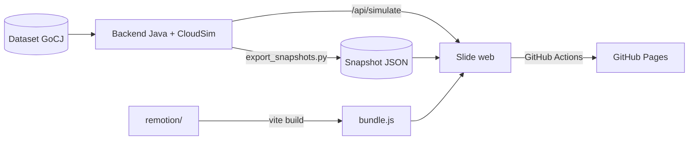

<div align="center">

<h1>Metaheuristik untuk Cloud Task Scheduling</h1>

<p>Slide interaktif Tugas 5 SOKA, Kelompok 5<br>
CSA dan PHS diadu dengan lima heuristik klasik di CloudSim</p>

[](https://rkaaaa404.github.io/soka-metaheuristik-kelompok-5/)
[](https://github.com/Rkaaaa404/soka-metaheuristik-kelompok-5/actions/workflows/pages.yml)


[Hasil simulasi](#hasil-simulasi) · [Isi slide](#isi-slide) · [Algoritma](#algoritma) · [Cara menjalankan](#cara-menjalankan) · [API](#http-api)

</div>

<br>

Kalau ada ribuan task dan puluhan VM, task mana yang sebaiknya jalan di VM mana? Repo ini menjawabnya lewat presentasi web 11 slide tentang dua algoritma metaheuristik, Clonal Selection Algorithm (CSA) dan Polyrhythmic Harmony Search (PHS). Keduanya kami jalankan di CloudSim 7.0.1 dengan dataset GoCJ (Google Cloud Jobs), lalu kami bandingkan dengan FCFS, RR, SJF, Min-Min, dan Max-Min.

Bagian yang paling enak dicoba ada di slide 8. CSA dan PHS jalan langsung di browser, dan tiap generasinya bisa diputar maju-mundur: klon muncul dari parent, gen yang bermutasi berganti warna, lalu task terbang ke VM di Gantt.

## Kelompok 5

| NRP | Nama |
| :-- | :-- |
| 5027241002 | Balqis Sani Sabillah |
| 5027241018 | Zaenal Mustofa |
| 5027241039 | Rayka Dharma Pranandita |
| 5027241083 | Mutiara Diva Jaladitha |
| 5027241101 | Binar Najmuddin Mahya |

## Hasil simulasi

Rata-rata makespan dalam detik, dari 5 run dengan seed 42. Infrastrukturnya 2 datacenter, 5 host per datacenter, dan 50 VM. Angka tercepat di tiap kolom ditebalkan.

| Algoritma | 1000 task | 5000 task | 10000 task |
| :-- | --: | --: | --: |
| PHS | **2062.00** | 6310.50 | **23173.25** |
| Min-Min | 2202.75 | 5748.00 | **23173.25** |
| Max-Min | 2352.00 | 5920.00 | 23174.50 |
| SJF | 2474.00 | 6410.00 | **23173.25** |
| FCFS | 3202.00 | **5406.50** | 23844.00 |
| CSA | 4227.40 | 25293.60 | 40562.80 |
| RR | 9888.00 | 30850.00 | 45404.00 |

PHS menang di 1000 task, tapi di 5000 task malah kalah dari FCFS, Min-Min, dan Max-Min. Di 10000 task, PHS, SJF, dan Min-Min mendapat makespan yang sama persis. CSA hanya lebih baik dari RR di ketiga ukuran, dan juga paling lama berpikir: 24 detik untuk menyusun jadwal 10000 task, sedangkan PHS cukup 774 ms.

Angka PHS di tabel sebenarnya angka seed HEFT, karena di semua run improvisasinya tidak pernah menghasilkan jadwal yang lebih baik. Di 1000 dan 10000 task itu wajar: HEFT sudah menyentuh batas bawah teoretis, yang ditentukan oleh satu task besar yang datang telat. Di 5000 task masih ada ruang 20.5% yang tidak berhasil diambil PHS.

Delapan metrik lainnya ada di slide 10. Data mentahnya di [`web/data/results/`](web/data/results/).

## Isi slide

| # | Slide | Yang ditampilkan |
| --: | :-- | :-- |
| 1 | Pengenalan | Judul dan anggota kelompok |
| 2 | Masalah | Antrean task, penempatan asal vs terencana di Gantt per VM, kalkulator ruang solusi Mᴺ |
| 3 | Metaheuristik | Lanskap fitness untuk exploration dan exploitation |
| 4 | CSA: inspirasi | Seleksi klonal di sistem imun, dipetakan ke penjadwalan |
| 5 | CSA: cara kerja | Flowchart 6 langkah, ilustrasi operator, rumus, kartu paper Jena (2017) |
| 6 | PHS: inspirasi | Improvisasi jazz dan poliritme 3:4, dipetakan ke penjadwalan |
| 7 | PHS: cara kerja | Flowchart 6 langkah, ilustrasi operator, kartu paper Melnik & Trofimenko (2015) |
| 8 | Lab interaktif | CSA dan PHS langkah demi langkah, dengan pseudocode, grafik konvergensi, arsip Pareto, dan parameter yang bisa diubah |
| 9 | Studi kasus | Infrastruktur CloudSim, heatmap utilisasi, timeline 1000 cloudlet |
| 10 | Evaluasi | 7 algoritma × 9 metrik, bar chart dan tabel mean ± sd |
| 11 | Kesimpulan | Takeaway yang dihitung dari data, 6 referensi |

Pindah slide pakai <kbd>←</kbd> <kbd>→</kbd>, <kbd>PageUp</kbd> <kbd>PageDown</kbd>, <kbd>Home</kbd> <kbd>End</kbd>, atau `#slide-N` di URL. Di lab, <kbd>,</kbd> dan <kbd>.</kbd> untuk mundur dan maju satu langkah, <kbd>Space</kbd> untuk play/pause.

## Algoritma

### CSA

Diadaptasi dari TSCSA milik Jena, terinspirasi dari cara sistem imun memperbanyak antibodi yang cocok dengan antigen. Solusi dikodekan sebagai integer diskret, jadi tidak perlu bit-repair. Afinitasnya gabungan berbobot dari makespan dan energi host. Jumlah klon dihitung dengan $C_r = \lfloor \beta \cdot P / r \rfloor$, dan antibodi berafinitas rendah bermutasi lebih agresif. Solusi non-dominated disimpan di arsip Pareto.

### PHS

Diadaptasi dari varian inventaris tetap Melnik & Trofimenko, terinspirasi dari improvisasi jazz poliritmik. PHS punya dua harmony memory: Schedule HM untuk urutan prioritas dan alokasi VM, Resource HM untuk faktor kapasitas VM (0, 0.5, atau 1.0). Satu entri awal diisi HEFT supaya start-nya tidak dari nol.

Ritme genap dan ganjil bergantian. Satu ritme mengimprovisasi jadwal lewat reassign dan swap, ritme lainnya mengatur kapasitas lewat deactivate, activate, dan reduce. Crossover dua titik dipakai untuk jadwal, interleaving untuk kapasitas, dan task yang jatuh ke VM nonaktif otomatis dipindah ke VM aktif.

### Baseline

| Algoritma | Cara memilih |
| :-- | :-- |
| FCFS | Urut waktu kedatangan, masuk ke slot paling awal yang bebas |
| RR | Bergiliran antar VM |
| SJF | Non-preemptive, ambil task terpendek yang sudah tiba, kirim ke VM yang paling cepat menyelesaikannya |
| Min-Min | Dahulukan task dengan waktu selesai minimum terkecil |
| Max-Min | Dahulukan task dengan waktu selesai minimum terbesar |

## Metrik

| Metrik | Rumus | Satuan | Bagus kalau |
| :-- | :-- | :-- | :-: |
| Makespan | $T = \max f_i$ | detik | rendah |
| Avg waiting time | $\text{mean}(s_i - a_i)$ | detik | rendah |
| Avg execution time | $\text{mean}(d_i)$ | detik | rendah |
| Avg turnaround time | $\text{mean}(f_i - a_i)$ | detik | rendah |
| Throughput | $N / T$ | task/detik | tinggi |
| Resource utilization | $100 \times \text{mean}(L_j) / T$ | % | tinggi |
| Degree of imbalance | $(\max L_j - \min L_j) / \text{mean}(L_j)$ | tanpa satuan | rendah |
| Total cost | CPU × tarif CloudSim 0.01 per detik | G$ | rendah |
| Scheduling time | Waktu komputasi scheduler | milidetik | rendah |

## Cara kerja repo



<details>
<summary><b>Struktur folder</b></summary>

```
task-5/
├── .github/workflows/pages.yml   # deploy web/ ke GitHub Pages
├── dataset/                      # 10 CSV GoCJ (1000 s.d. 10000 task) + 2 dataset teks asli
├── docs/                         # 2 paper rujukan (PDF)
├── java/                         # backend Java + CloudSim 7.0.1 (Gradle) + JUnit
├── scripts/export_snapshots.py   # ekspor hasil CloudSim ke web/data/results/
├── remotion/                     # komposisi Remotion (React + TS)
│   └── src/
│       ├── index.tsx             # jembatan Player dan JS slide
│       ├── primitives/           # GeneRows, TaskGantt, Staged, ui
│       └── compositions/         # lab/, flows/, stories/
└── web/
    ├── index.html                # 11 slide
    ├── styles.css, viz.css
    ├── js/
    │   ├── app.js                # navigasi slide dan lifecycle animasi
    │   ├── api.js                # deteksi backend, fallback ke data statis
    │   ├── results.js            # slide studi kasus, evaluasi, kesimpulan
    │   ├── scenario-form.js      # form skenario CloudSim (mode live)
    │   ├── algorithms/           # CSA, PHS, decoder, RNG Mulberry32 (sama dengan versi Java)
    │   ├── viz/                  # scene, flow, kontrol lab
    │   └── remotion/bundle.js    # hasil build remotion/, tidak di-commit
    ├── data/                     # sampel task GoCJ dan snapshot CloudSim
    └── papers/                   # salinan PDF untuk tautan relatif
```

</details>

## Cara menjalankan

Butuh JDK 21 ke atas, Node.js 20 ke atas (CI memakai 22), dan browser modern.

**1. Build animasi.** Wajib sekali di awal dan setiap `remotion/` berubah. Tanpa `bundle.js` slide tidak bisa dimuat.

```powershell
cd remotion
npm ci
npm run build
npm run studio   # opsional, untuk melihat tiap komposisi
```

**2. Jalankan backend.**

```powershell
cd java
.\gradlew.bat run
```

**3. Buka [http://localhost:8080](http://localhost:8080).**

Slide punya dua mode, dan badge di header menunjukkan mode yang aktif:

| | Backend CloudSim live | Snapshot CloudSim |
| :-- | :-- | :-- |
| Kapan | Dijalankan lewat backend Java | GitHub Pages atau server statis |
| Slide 2–8 | Algoritma dihitung di browser | Algoritma dihitung di browser |
| Slide 9–11 | Bisa simulasi baru dengan konfigurasi sendiri | Hasil simulasi 1000, 5000, dan 10000 task (5 run, seed 42) |

Mode statis bisa dicoba di lokal dengan `python -m http.server 8000 -d web`.

> [!NOTE]
> VM dibagi per host: 2 Small, 2 Medium, dan 1 Large, jadi 25 VM per datacenter dan 50 VM total. Skenario minimal tugas hanya 5 VM per datacenter, tapi 10 VM terlalu sedikit untuk 1000 sampai 10000 job.

<details>
<summary><b>Memperbarui snapshot</b></summary>

```powershell
cd java; .\gradlew.bat run          # terminal 1
python scripts/export_snapshots.py  # terminal 2
```

Skrip memanggil `/api/simulate`, menunggu job selesai, lalu menulis `web/data/results/gocj-<N>.json` dan `index.json`. Defaultnya 1000, 5000, dan 10000 task dengan 5 run. Alokasi per cloudlet hanya disimpan untuk skenario terkecil supaya situs tetap ringan.

</details>

<details>
<summary><b>Port lain dan distribusi terkompilasi</b></summary>

```powershell
cd java
.\gradlew.bat installDist
.\build\install\cloud-scheduling\bin\cloud-scheduling.bat --port=8080
```

</details>

<details>
<summary><b>Hasil eksperimen lokal</b></summary>

Setiap eksperimen baru otomatis tersimpan di folder sendiri, jadi tidak menimpa eksperimen sebelumnya:

```text
java/build/results/<jobId>/metrik.csv
java/build/results/<jobId>/status.json
```

Satu baris CSV berisi satu algoritma dalam satu run: sembilan metrik, seed, hash SHA-256 dataset, versi engine, timestamp, dan konfigurasi lengkap di kolom `scenarioJson`. Lokasi absolutnya muncul di slide 9 setelah run live dan di `result.exports.metricsCsv` pada respons API.

CSV ditulis setiap satu run CloudSim selesai, jadi hasil parsial tetap ada kalau eksperimen gagal atau timeout. Cek `status.json`: eksperimen baru dianggap lengkap kalau `status` bernilai `SUCCEEDED` dan `complete` bernilai `true`. Membaca ulang cache default tidak menghasilkan CSV baru.

Kolom energi berisi estimasi dari decoder jadwal (`energySource=decoded-schedule-estimate`), jadi jangan dibaca sebagai hasil ukur CloudSim.

</details>

## HTTP API

| Endpoint | Fungsi |
| :-- | :-- |
| `GET /api/datasets` | Daftar 10 dataset GoCJ dengan jumlah baris dan SHA-256 |
| `GET /api/datasets/{filename}/tasks?limit=N` | N task pertama (1 s.d. 30) untuk visualisasi |
| `POST /api/simulate` | Validasi skenario dan mulai simulasi. Balas 202 dengan `jobId`, atau 409 `SIMULATION_BUSY` kalau masih ada job lain |
| `GET /api/simulations/{jobId}` | Status (`RUNNING`, `SUCCEEDED`, `FAILED`, `TIMED_OUT`) dan progress |
| `GET /api/default-result` | Hasil skenario default dari cache, atau dijalankan dulu kalau belum ada |
| `GET /docs/{filename}` | PDF paper rujukan |

## Paper rujukan

- Jena (2017), [Clonal Selection Algorithm](web/papers/csa-jena-2017.pdf)
- Melnik & Trofimenko (2015), [Polyrhythmic Harmony Search](web/papers/phs-melnik-2015.pdf)
