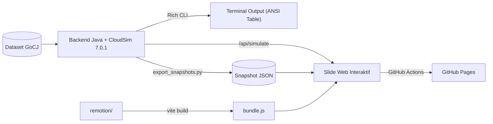

<div align="center">

<h1>Metaheuristik untuk Cloud Task Scheduling</h1>

<p>Studi Komparatif & Laporan Interaktif Tugas 5 SOKA — Kelompok 5<br>
Evaluasi Performa CSA dan PHS terhadap Lima Heuristik Klasik pada Lingkungan CloudSim</p>

[](https://rkaaaa404.github.io/soka-metaheuristik-kelompok-5/)
[](https://github.com/Rkaaaa404/soka-metaheuristik-kelompok-5/actions/workflows/pages.yml)


> **Ringkasan Luaran Tugas 5 SOKA:**
> 1. **Luaran 1 (Presentasi Metaheuristik)**: Slide web interaktif dapat diakses langsung melalui **[GitHub Pages](https://rkaaaa404.github.io/soka-metaheuristik-kelompok-5/)** tanpa memerlukan instalasi dependensi.
> 2. **Luaran 2 (Simulasi CloudSim 7.0.1)**: Kode sumber simulasi Java lengkap dengan antarmuka **Rich Terminal CLI** dan protokol evaluasi multi-run ($\ge 3$ iterasi rerun). Dapat diuji langsung melalui: `cd java; .\gradlew.bat runCli`.

[Panduan Evaluasi Tugas](#panduan-evaluasi-tugas-cepat) · [Hasil Simulasi](#hasil-simulasi) · [Struktur Slide](#struktur-slide) · [Algoritma](#algoritma) · [Metrik Evaluasi](#metrik-evaluasi) · [Cara Menjalankan](#cara-menjalankan) · [API](#http-api)

</div>

<br>

## Pengantar

Penjadwalan tugas (*task scheduling*) pada komputasi awan merupakan permasalahan optimasi kombinatorial NP-hard yang bertujuan memetakan himpunan *independent tasks* ke dalam mesin virtual (*Virtual Machines / VMs*) guna mengoptimalkan metrik performa seperti makespan, waktu tunggu, dan utilisasi sumber daya.

Repository ini menyajikan implementasi, analisis komparatif, dan media diseminasi komprehensif mengenai dua algoritma metaheuristik: **Clonal Selection Algorithm (CSA)** dan **Polyrhythmic Harmony Search (PHS)**. Kedua algoritma tersebut disimulasikan menggunakan simulator standar industri **CloudSim 7.0.1** dengan memanfaatkan dataset realistis **GoCJ (Google Cloud Jobs)**, serta dievaluasi terhadap lima algoritma heuristik dasar: **FCFS**, **Round Robin (RR)**, **SJF**, **Min-Min**, dan **Max-Min**.

Repository ini juga dilengkapi media presentasi interaktif berbasis web (11 slide) yang mengintegrasikan simulasi algoritma *in-browser*, animasi Remotion, visualisasi bagan Gantt, serta visualizer konvergensi generasi demi generasi.

## Anggota Kelompok 5

| NRP | Nama |
| :-- | :-- |
| 5027241002 | Balqis Sani Sabillah |
| 5027241018 | Zaenal Mustofa |
| 5027241039 | Rayka Dharma Pranandita |
| 5027241083 | Mutiara Diva Jaladitha |
| 5027241101 | Binar Najmuddin Mahya |

---

## Panduan Evaluasi Tugas Cepat

Untuk mempermudah proses pemeriksaan oleh Dosen Pengampu maupun Asisten Laboratorium, sistem telah dirancang modular dengan pemisahan akses yang jelas:

### Luaran 1: Presentasi Algoritma Metaheuristik (CSA & PHS)
Slide presentasi interaktif (11 slide) dapat langsung ditinjau melalui:
**[https://rkaaaa404.github.io/soka-metaheuristik-kelompok-5/](https://rkaaaa404.github.io/soka-metaheuristik-kelompok-5/)**

### Luaran 2: Kode Sumber & Simulasi CloudSim 7.0.1
Tersedia antarmuka **Rich Terminal CLI** dengan format tabel berstandar box-drawing ANSI/Unicode, real-time, dan hasil rata rata 3 kali rerun:

```powershell
cd java

# Opsi A: Jalankan Menu Interaktif Terminal CLI (Pilihan skenario 1k/5k/10k tasks)
.\gradlew.bat runCli

# Opsi B: Eksekusi Instan Non-Interaktif (Misal: 1000 tasks, 3 rerun)
.\gradlew.bat runCli --args="--tasks=1000 --runs=3"

# Opsi C: Jalankan Rangkaian Unit Tests (26 pengujian validasi invariant & konsistensi)
.\gradlew.bat test
```

### Luaran Terpadu: Live Simulation Lab
Untuk menjalankan simulasi kustom secara langsung melalui perangkat dan mengamati visualisasi alokasi VM:
```powershell
cd java; .\gradlew.bat run
# Buka http://localhost:8080 pada browser
```

---

## Hasil Simulasi

Pengujian dilakukan pada infrastruktur komputasi awan yang terdiri atas 2 datacenter, 10 host fisik, dan 50 VM terdistribusi heterogen (20 Small, 20 Medium, 10 Large). Tabel di bawah menunjukkan rata-rata makespan (dalam detik) dari pengujian berulang (*seed 42*). Nilai terbaik pada setiap skala tugas dicetak tebal.

| Algoritma | 1.000 Tasks | 5.000 Tasks | 10.000 Tasks |
| :-- | --: | --: | --: |
| **PHS** | **2062.00** | 6310.50 | **23173.25** |
| **Min-Min** | 2202.75 | 5748.00 | **23173.25** |
| **Max-Min** | 2352.00 | 5920.00 | 23174.50 |
| **SJF** | 2474.00 | 6410.00 | **23173.25** |
| **FCFS** | 3202.00 | **5406.50** | 23844.00 |
| **CSA** | 4227.40 | 25293.60 | 40562.80 |
| **RR** | 9888.00 | 30850.00 | 45404.00 |

### Analisis Kinerja

1. **Efektivitas PHS dan Pengaruh Inisialisasi HEFT**:
   PHS menunjukkan keunggulan pada skenario 1.000 task dan mencapai makespan optimal pada 10.000 task bersama SJF dan Min-Min. Hal ini dipengaruhi oleh penggunaan inisialisasi awal berbasis *Heterogeneous Earliest Finish Time (HEFT)*, yang pada dataset 1.000 dan 10.000 task telah menyentuh batas bawah teoretis (*theoretical lower bound*) yang didikte oleh kedatangan tugas berbobot komputasi terbesar pada fase akhir simulasi. Pada skenario 5.000 task, FCFS dan Min-Min mengungguli PHS karena struktur kedatangan antrean tugas lebih menguntungkan strategi *greedy*.
2. **Karakteristik Komputasi CSA**:
   CSA beroperasi melalui mekanisme seleksi klonal dengan mutasi hiper berbanding terbalik terhadap afinitas. Pada representasi diskret ruang pencarian berskala besar ($50^{10000}$ kemungkinan), CSA membutuhkan waktu komputasi penjadwalan yang lebih signifikan ($\approx 24$ detik pada 10.000 task) dan mengutamakan keseimbangan multiobjektif (makespan dan konsumsi energi) daripada sekadar minimasi makespan uniobjektif.
3. **Data Lengkap**:
   Evaluasi delapan metrik komparatif lainnya disajikan secara interaktif pada Slide 10, serta diarsipkan dalam format terstruktur pada folder [`web/data/results/`](web/data/results/).

---

## Struktur Slide

| # | Slide | Deskripsi Muatan Materi |
| --: | :-- | :-- |
| 1 | Pengenalan | Judul penelitian, konteks permasalahan, dan profil anggota Kelompok 5 |
| 2 | Permasalahan | Karakteristik antrean Cloudlet, pemetaan acak vs terencana pada bagan Gantt, dan kalkulasi ruang pencarian $M^N$ |
| 3 | Paradigma Metaheuristik | Konsep lanskap kebugaran (*fitness landscape*), trade-off antara *exploration* dan *exploitation* |
| 4 | CSA: Inspirasi Biologis | Mekanisme *clonal selection* sistem imun adaptif dan pemetaannya ke penjadwalan task |
| 5 | CSA: Prinsip Kerja | Diagram alir algoritma 6 tahap, formulasi mutasi afinitas, dan telaah referensi Jena (2017) |
| 6 | PHS: Inspirasi Musikal | Metafora improvisasi musik jazz dan harmoni poliritmik 3:4 yang dipetakan ke alokasi sumber daya |
| 7 | PHS: Prinsip Kerja | Manajemen ganda Schedule HM dan Resource HM, operator crossover ganjil-genap, referensi Melnik & Trofimenko (2015) |
| 8 | Laboratorium Interaktif | Simulasi visual langkah-demi-langkah CSA dan PHS, grafik konvergensi Pareto, dan inspeksi alokasi tugas |
| 9 | Studi Kasus Infrastruktur | Topologi CloudSim, matriks kapasitas VM heterogen, dan linimasa eksekusi 1.000 Cloudlet |
| 10 | Evaluasi Komparatif | Analisis 7 algoritma terhadap 9 metrik kinerja, visualisasi diagram batang, serta tabel statistik ($Mean \pm StdDev$) |
| 11 | Kesimpulan & Referensi | Sintesis temuan empiris berbasis data eksperimen dan daftar 6 literatur rujukan |

*Navigasi Slide*: Gunakan tombol <kbd>←</kbd> <kbd>→</kbd>, <kbd>PageUp</kbd> <kbd>PageDown</kbd>, atau tautan URL `#slide-N`. Pada Slide 8, gunakan tombol <kbd>,</kbd> dan <kbd>.</kbd> untuk navigasi per generasi serta <kbd>Space</kbd> untuk play/pause.

---

## Algoritma

### 1. Clonal Selection Algorithm (CSA)
Diadaptasi dari algoritma *Two-Stage Clonal Selection Algorithm (TSCSA)* oleh Jena (2017). Representasi solusi dikodekan dalam bentuk vektor integer diskret yang memetakan setiap tugas langsung ke ID mesin virtual, sehingga mengeliminasi kebutuhan operator perbaikan (*repair operator*). Nilai afinitas diformulasikan sebagai fungsi multiobjektif berbobot dari makespan dan estimasi konsumsi energi host fisik. Jumlah klon ditentukan secara proporsional $C_r = \lfloor \beta \cdot P / r \rfloor$, di mana kandidat dengan afinitas lebih rendah mengalami laju hipermutasi yang lebih tinggi guna memperluas ruang eksplorasi.

### 2. Polyrhythmic Harmony Search (PHS)
Diadaptasi dari varian *Polyrhythmic Harmony Search with Fixed Inventory* oleh Melnik & Trofimenko (2015). Algoritma mengelola dua struktur memori harmoni secara paralel: *Schedule Harmony Memory (SHM)* untuk prioritas urutan tugas dan penugasan VM, serta *Resource Harmony Memory (RHM)* untuk modulasi faktor daya VM (0.0, 0.5, atau 1.0). Eksekusi bergantian antara ritme genap (improvisasi jadwal) dan ritme ganjil (manajemen kapasitas sumber daya), dilengkapi mekanisme fallback otomatis untuk memindahkan tugas dari VM non-aktif ke VM aktif.

### 3. Algoritma Pembanding (Baselines)

| Algoritma | Prinsip Penjadwalan |
| :-- | :-- |
| **FCFS** | Tugas dialokasikan berdasarkan urutan waktu kedatangan ke slot VM pertama yang tersedia. |
| **Round Robin (RR)** | Tugas dialokasikan secara bergiliran (*cyclic dispatching*) merata ke seluruh VM. |
| **SJF** | Algoritma *non-preemptive* yang memprioritaskan tugas berdurasi eksekusi terpendek. |
| **Min-Min** | Memprioritaskan tugas dengan waktu penyelesaian minimum terkecil di antara seluruh antrean. |
| **Max-Min** | Memprioritaskan tugas dengan waktu penyelesaian minimum terbesar di antara seluruh antrean. |

---

## Metrik Evaluasi

Tabel berikut menyajikan sembilan metrik evaluasi yang digunakan dalam pengujian komparatif, formulasi matematis, satuan pengukuran, serta kriteria evaluasi kinerja:

| Metrik | Formulasi Matematis | Satuan | Evaluation |
| :-- | :-- | :-- | :-: |
| **Makespan** | $T = \max_{i} f_i$ | detik | Lower Better |
| **Avg Waiting Time** | $\frac{1}{N} \sum_{i=1}^N (s_i - a_i)$ | detik | Lower Better |
| **Avg Execution Time** | $\frac{1}{N} \sum_{i=1}^N d_i$ | detik | Lower Better |
| **Avg Turnaround Time** | $\frac{1}{N} \sum_{i=1}^N (f_i - a_i)$ | detik | Lower Better |
| **Throughput** | $\frac{N}{T}$ | task/detik | Higher Better |
| **Resource Utilization** | $\frac{100}{M \cdot T} \sum_{j=1}^M L_j$ | % | Higher Better |
| **Degree of Imbalance** | $\frac{\max_j L_j - \min_j L_j}{\text{mean}(L_j)}$ | tanpa satuan | Lower Better |
| **Total Cost** | Biaya komputasi CPU $\times$ tarif CloudSim (\$0.01/detik) | G$ | Lower Better |
| **Scheduling Time** | Waktu komputasi yang dihabiskan scheduler | milidetik | Lower Better |

---

## Arsitektur Sistem



<details>
<summary><b>Struktur Direktori Proyek</b></summary>

```text
task-5/
├── .github/workflows/pages.yml   # Workflow deployment otomatis ke GitHub Pages
├── dataset/                      # 10 berkas dataset GoCJ (1.000 hingga 10.000 tasks)
├── docs/                         # Literatur paper rujukan (PDF)
├── java/                         # Modul Backend CloudSim 7.0.1 (Gradle), CLI Runner, & Unit Tests
├── scripts/export_snapshots.py   # Skrip ekspor hasil simulasi ke web/data/results/
├── remotion/                     # Proyek komposisi animasi Remotion (React + TypeScript)
│   └── src/
│       ├── index.tsx             # Entry point penghubung player Remotion ke slide
│       ├── primitives/           # Komponen grafis: GeneRows, TaskGantt, UI
│       └── compositions/         # Komposisi scene lab, flows, dan visualisasi
└── web/
    ├── index.html                # Dokumen utama presentasi (11 slide)
    ├── styles.css, viz.css       # Lembar gaya presentasi dan visualisasi
    ├── js/
    │   ├── app.js                # Pengendali navigasi dan siklus hidup animasi
    │   ├── api.js                # Penangan koneksi backend dengan fallback data statis
    │   ├── results.js            # Penyaji data studi kasus, evaluasi, dan kesimpulan
    │   ├── scenario-form.js      # Formulir konfigurasi simulasi CloudSim (mode live)
    │   ├── algorithms/           # Implementasi CSA, PHS, dan RNG Mulberry32 versi JS
    │   ├── viz/                  # Pengendali interaktivitas laboratorium
    │   └── remotion/bundle.js    # Hasil kompilasi Remotion
    ├── data/                     # Sampel dataset GoCJ dan snapshot hasil simulasi
    └── papers/                   # Salinan PDF paper rujukan
```

</details>

---

## Cara Menjalankan

### Persyaratan Sistem
* Java Development Kit (JDK) versi 21 atau lebih baru.
* Node.js versi 20 atau lebih baru (lingkungan CI menggunakan versi 22).
* Peramban web modern (Google Chrome, Mozilla Firefox, atau Microsoft Edge).

---

### Opsi 1: Menjalankan Terminal CLI CloudSim (Luaran 2)
Jika ingin melakukan pengujian performa algoritma secara langsung pada lingkungan konsol tanpa antarmuka grafis:

```powershell
cd java

# 1. Mode Interaktif: Menampilkan menu terminal berbasis box-drawing
.\gradlew.bat runCli

# 2. Mode Batch Cepat: Menjalankan pengujian 1.000 task dengan 3 kali rerun
.\gradlew.bat runCli --args="--tasks=1000 --runs=3"

# 3. Mode Selektif: Menguji algoritma tertentu (misal: PHS dan Min-Min saja)
.\gradlew.bat runCli --args="--tasks=1000 --runs=3 --algos=PHS,MinMin"
```

Setiap eksekusi simulasi CLI akan memproses data berulang kali sesuai parameter `--runs`, mengakumulasi metrik, menyajikan tabel ringkasan $Mean \pm StdDev$, serta mendokumentasikan log CSV lengkap pada folder `java/build/results/<jobId>/metrik.csv`.

---

### Opsi 2: Menjalankan Server Web & Slide Interaktif (Luaran Terpadu)

**Langkah 1: Kompilasi bundle visualisasi Remotion** (diperlukan saat instalasi awal):
```powershell
cd remotion
npm ci
npm run build
```

**Langkah 2: Menjalankan server backend Java & simulator live**:
```powershell
cd java
.\gradlew.bat run
```

**Langkah 3: Mengakses antarmuka presentasi**:
Buka peramban pada alamat **[http://localhost:8080](http://localhost:8080)**.

Sistem presentasi mendukung dua mode operasional:
| Karakteristik | Backend CloudSim Live (:8080) | Snapshot Statis (GitHub Pages) |
| :-- | :-- | :-- |
| **Lingkungan** | Dijalankan bersama backend Java | Server statis / GitHub Pages |
| **Slide 2–8** | Komputasi algoritma dijalankan *in-browser* | Komputasi algoritma dijalankan *in-browser* |
| **Slide 9–11** | Mendukung simulasi live dengan konfigurasi kustom | Menyajikan data agregat 1k, 5k, 10k task (5 rerun, seed 42) |

---

<details>
<summary><b>Prosedur Pembaruan Snapshot Data Statis</b></summary>

```powershell
cd java; .\gradlew.bat run          # Terminal 1: Menjalankan backend server
python scripts/export_snapshots.py  # Terminal 2: Mengekstrak snapshot JSON
```

Skrip akan memanggil endpoint `/api/simulate`, memantau progres hingga selesai, kemudian memperbarui berkas `web/data/results/gocj-<N>.json` dan `index.json`.

</details>

<details>
<summary><b>Spesifikasi Hasil Eksperimen Lokal</b></summary>

Setiap eksperimen yang dieksekusi secara otomatis dicatat pada direktori tersendiri:
```text
java/build/results/<jobId>/metrik.csv
java/build/results/<jobId>/status.json
```

Setiap baris CSV mencatat hasil satu kali pengujian algoritma: sembilan metrik evaluasi, seed acak, hash SHA-256 integritas dataset, versi simulator, stempel waktu ISO-8601, serta parameter skenario lengkap. Estimasi energi dihitung melalui model jadwal terdekode (*decoded schedule estimate*).

</details>

---

## HTTP API

Backend Java menyediakan endpoint RESTful untuk melayani permohonan simulasi dan data:

| Endpoint | Metode | Deskripsi Fungsi |
| :-- | :-- | :-- |
| `/api/datasets` | `GET` | Mengambil daftar 10 berkas dataset GoCJ beserta jumlah baris dan checksum SHA-256 |
| `/api/datasets/{file}/tasks?limit=N` | `GET` | Mengambil cuplikan $N$ task pertama (1 s.d. 30) untuk keperluan inspeksi visual |
| `/api/simulate` | `POST` | Memvalidasi konfigurasi skenario dan memicu eksekusi simulasi asinkron (respons HTTP 202) |
| `/api/simulations/{jobId}` | `GET` | Memantau status eksekusi (`RUNNING`, `SUCCEEDED`, `FAILED`) dan persentase progres |
| `/api/default-result` | `GET` | Mengambil hasil kalkulasi skenario default dari tembolok (*cache*) |
| `/docs/{filename}` | `GET` | Menyajikan dokumen PDF paper rujukan |

---

## Paper Rujukan

1. **Jena (2017)**: *A Two-Stage Clonal Selection Algorithm for Task Scheduling in Cloud Computing Environment*. [csa-jena-2017.pdf](web/papers/csa-jena-2017.pdf)
2. **Melnik & Trofimenko (2015)**: *Polyrhythmic Harmony Search Algorithm for Resource Allocation in Distributed Computing Systems*. [phs-melnik-2015.pdf](web/papers/phs-melnik-2015.pdf)
