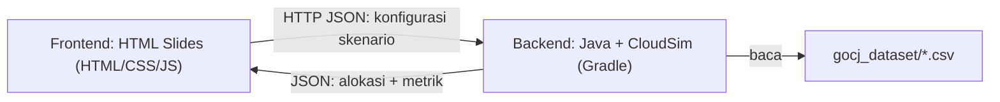

# Tugas 5 — Presentasi Web: Metaheuristik untuk Cloud Task Scheduling

## 1. Tujuan

Membuat **media presentasi berbasis web (HTML slides)** yang menjelaskan algoritma
metaheuristik untuk **cloud task scheduling**, lengkap dengan visualisasi interaktif
dan evaluasi berdasarkan hasil simulasi nyata.

## 2. Konteks

| Item                  | Keterangan                                                        |
| --------------------- | ----------------------------------------------------------------- |
| Mata kuliah           | SOKA (Semester 5)                                                 |
| Algoritma yang dipilih | **Clonal Selection Algorithm (CSA)** dan **Polyrhythmic Harmony Search (PHS)** |
| Paper rujukan         | [`Clonal Selection Algorithm (CSA).pdf`](./Clonal%20Selection%20Algorithm%20(CSA).pdf), [`Polyrhythmic Harmony Search.pdf`](./Polyrhythmic%20Harmony%20Search.pdf) |
| Tools simulasi        | Java + **CloudSim**, build dengan **Gradle**                      |
| Dataset task          | **GoCJ** (Google Cloud Jobs) — folder [`gocj_dataset/`](./gocj_dataset) |
| Output akhir          | Web slides (HTML/CSS/JS)                                          |

## 3. Struktur Konten Slide (Deliverables)

### Slide 1 — Pengenalan
- **Kelompok 5**
- Anggota:

  | NRP        | Nama                       |
  | ---------- | -------------------------- |
  | 5027241002 | Balqis Sani Sabillah       |
  | 5027241018 | Zaenal Mustofa             |
  | 5027241039 | Rayka Dharma Pranandita    |
  | 5027241083 | Mutiara Diva Jaladitha     |
  | 5027241101 | Binar Najmuddin Mahya      |

### Slide 2 — Metaheuristik dalam Task Scheduling
- Penjelasan singkat apa itu algoritma metaheuristik
- Mengapa metaheuristik relevan untuk masalah penjadwalan task di cloud

### Slide 3 — Penjelasan Algoritma Terpilih
- **CSA**: konsep, alur/langkah algoritma, parameter utama
- **PHS**: konsep, alur/langkah algoritma, parameter utama
- Materi **wajib** bersumber dari kedua paper rujukan di atas

### Slide 4 — Visualisasi Interaktif
- Gaya referensi: **[VisuAlgo](https://visualgo.net/)**
- Visualisasi **dijalankan oleh kode secara live** di browser (bukan gambar/animasi pre-generated)
- Pengguna dapat berinteraksi (mis. menjalankan langkah demi langkah, mengubah input/parameter)
- Disediakan untuk CSA dan PHS
- **Panel konfigurasi skenario** yang bisa diubah pengguna sebelum simulasi dijalankan:

  | Parameter              | Input                                   | Default (sesuai §6.3)       |
  | ---------------------- | --------------------------------------- | --------------------------- |
  | Jumlah task            | Pilih file GoCJ (1000–10000) atau subset N task pertama | 1000            |
  | Jumlah datacenter      | Angka (min. 1)                          | 2                           |
  | Host per datacenter    | Angka (min. 1)                          | 5                           |
  | VM per datacenter      | Angka (min. 1)                          | 5                           |
  | Distribusi tipe VM     | Jumlah Small / Medium / Large per datacenter (total = VM per datacenter) | 2 / 2 / 1 |

- Validasi input: total distribusi tipe VM harus sama dengan jumlah VM per datacenter
  (divalidasi di frontend **dan** backend)
- Dua mode di slide ini:
  1. **Step-by-step (JavaScript)** — animasi internal algoritma (populasi/antibodi, harmony memory,
     iterasi, fitness) dengan subset task kecil agar mudah diikuti
  2. **Run CloudSim (Backend)** — konfigurasi di atas dikirim ke backend, CloudSim dijalankan
     secara nyata, lalu alokasi task → VM dan metrik (§6.2) ditampilkan

### Slide 5 — Evaluasi & Perbandingan
- Bandingkan CSA & PHS dengan **algoritma heuristik lain** (baseline, lihat §6.1)
- Gunakan **banyak metrik** (lihat §6.2), bukan hanya satu
- Disajikan dalam bentuk **tabel** (boleh ditambah grafik)
- Data **wajib** berasal dari **hasil uji simulasi nyata** (CloudSim), bukan data karangan
- Konfigurasi skenario (sama seperti panel Slide 4) dapat diubah; tombol **Run** memicu
  backend menjalankan CloudSim untuk **semua algoritma** lalu tabel diperbarui
- Tampilkan hasil skenario default (§6.3) saat slide pertama dibuka, sebagai baseline presentasi

## 4. Kebutuhan Teknis

### 4.1 Arsitektur



1. **Frontend (Presentasi)**: HTML slides; visualisasi step-by-step algoritma diimplementasikan
   dalam JavaScript; memanggil backend untuk simulasi CloudSim.
2. **Backend (Simulasi)**: aplikasi Java (Gradle) berisi implementasi CSA, PHS, dan seluruh baseline
   di atas CloudSim, diekspos sebagai **HTTP API** (mis. Javalin / Spark Java / HttpServer bawaan JDK).
3. **Menjalankan**: satu perintah Gradle (mis. `gradle run`) menyalakan backend sekaligus
   menyajikan file slides, sehingga presentasi cukup dibuka di `http://localhost:<port>`.

### 4.2 Kontrak API (usulan)

`POST /api/simulate`

```json
{
  "algorithms": ["CSA", "PHS", "FCFS", "RR", "SJF", "MinMin", "MaxMin"],
  "taskCount": 1000,
  "datacenters": 2,
  "hostsPerDatacenter": 5,
  "vmsPerDatacenter": 5,
  "vmDistribution": { "small": 2, "medium": 2, "large": 1 },
  "runs": 5,
  "seed": 42
}
```

Respons: per algoritma berisi metrik §6.2 (rata-rata & simpangan baku bila `runs` > 1)
dan pemetaan `taskId → vmId` untuk visualisasi.

### 4.3 Catatan Non-Fungsional
- Validasi input di backend (nilai minimum, total distribusi VM, `taskCount` ≤ ukuran dataset).
- Simulasi besar (mis. 10000 task × beberapa run) bisa lama → tampilkan **indikator loading/progress**
  dan beri batas waktu (timeout) yang wajar.
- Hasil skenario default boleh di-cache agar Slide 5 cepat tampil saat presentasi.

## 5. Aturan Penting (Acceptance Criteria)

- [ ] Kelima bagian slide di atas tersedia.
- [ ] Penjelasan algoritma konsisten dengan paper rujukan.
- [ ] Visualisasi bersifat interaktif & dihitung secara live, bukan pre-generated.
- [ ] Jumlah task, datacenter, host, VM, dan distribusi tipe VM dapat diatur di Slide 4 dan Slide 5.
- [ ] Perubahan konfigurasi memicu simulasi CloudSim nyata melalui backend Java.
- [ ] Angka evaluasi berasal dari simulasi CloudSim yang benar-benar dijalankan.

## 6. Spesifikasi Evaluasi

### 6.1 Algoritma Pembanding (Baseline Heuristik)

Minimal 4 baseline. Yang digunakan:

| #  | Algoritma                    | Ringkasan                                                       |
| -- | ---------------------------- | --------------------------------------------------------------- |
| 1  | First Come First Serve (FCFS) | Task dialokasikan sesuai urutan kedatangan                      |
| 2  | Round Robin (RR)             | Task dibagi bergiliran ke VM                                    |
| 3  | Shortest Job First (SJF)     | Task terpendek dialokasikan lebih dulu                          |
| 4  | Min-Min                      | Pilih task dengan completion time minimum, ke VM tercepat        |
| 5  | Max-Min                      | Pilih task dengan completion time maksimum, ke VM tercepat       |

### 6.2 Metrik Evaluasi

| Metrik                           | Keterangan                                              | Lebih baik |
| -------------------------------- | ------------------------------------------------------- | ---------- |
| Makespan                         | Waktu selesai task terakhir                             | ↓ rendah   |
| Average Waiting Time             | Rata-rata waktu tunggu task sebelum dieksekusi          | ↓ rendah   |
| Average Execution Time           | Rata-rata lama eksekusi task                            | ↓ rendah   |
| Average Turnaround/Response Time | Rata-rata waktu dari submit hingga selesai              | ↓ rendah   |
| Throughput                       | Jumlah task selesai per satuan waktu                    | ↑ tinggi   |
| Resource Utilization             | Rata-rata pemakaian VM selama simulasi                  | ↑ tinggi   |
| Degree of Imbalance (DI)         | Ketidakseimbangan beban antar VM                        | ↓ rendah   |
| Total Cost                       | Biaya pemakaian resource (berdasarkan tarif CloudSim)   | ↓ rendah   |
| Scheduling Time                  | Waktu komputasi algoritma untuk membuat jadwal          | ↓ rendah   |

### 6.3 Skenario Simulasi (CloudSim)

**Infrastruktur (wajib, minimal):**
- **2 Datacenter**
- Setiap datacenter: **5 Host** dan **5 VM**
- Komposisi VM per datacenter: **2 Small, 2 Medium, 1 Large**
- Total: 10 Host, 10 VM (4 Small, 4 Medium, 2 Large)

**Spesifikasi VM (usulan, boleh disesuaikan):**

| Tipe   | MIPS | PEs | RAM (MB) | Bandwidth (Mbps) | Storage (MB) |
| ------ | ---- | --- | -------- | ---------------- | ------------ |
| Small  | 500  | 1   | 512      | 500              | 10000        |
| Medium | 1000 | 2   | 1024     | 1000             | 10000        |
| Large  | 2000 | 4   | 2048     | 1000             | 10000        |

**Beban task (cloudlet) — Dataset GoCJ:**

Sumber: folder [`gocj_dataset/`](./gocj_dataset)

| File                              | Isi                                                        |
| --------------------------------- | ---------------------------------------------------------- |
| `GoCJ_Dataset_<N>.csv`            | N task, N = 1000, 2000, …, 10000 (kelipatan 1000)          |
| `Original_DataSet.txt`            | Daftar panjang job unik (MI) dari GoCJ asli — referensi saja |
| `Original_Enhanced_Dataset.txt`   | 50 panjang job (MI) versi enhanced — referensi saja         |
| `DATA_CORRECTIONS.md`             | Catatan koreksi data (wajib dibaca sebelum memakai dataset) |

Format CSV (**tanpa header**, dipisah koma):

| Kolom | Nama          | Keterangan                                   |
| ----- | ------------- | -------------------------------------------- |
| 1     | `length`      | Panjang task dalam MI → `cloudletLength`     |
| 2     | `sla`         | Kelas SLA, domain **1–3** (tolak nilai di luar domain) |
| 3     | `arrivalTime` | Waktu kedatangan task                        |

Contoh baris: `83000,1,1` → task 83.000 MI, SLA 1, tiba pada t=1.

Aturan pemakaian:
- Skenario jumlah task (usulan): **1000, 5000, 10000** (boleh ditambah file lain)
- Seluruh algoritma (CSA, PHS, dan baseline) memakai **file dataset yang sama** per skenario
- `GoCJ_Dataset_5000.csv` baris 4986 telah dikoreksi (SLA 4 → 2), lihat `DATA_CORRECTIONS.md`
- Algoritma stokastik (CSA, PHS) dijalankan beberapa kali (mis. 5–10 run) dengan **seed tercatat**,
  lalu dilaporkan **rata-rata** (dan simpangan baku jika memungkinkan)